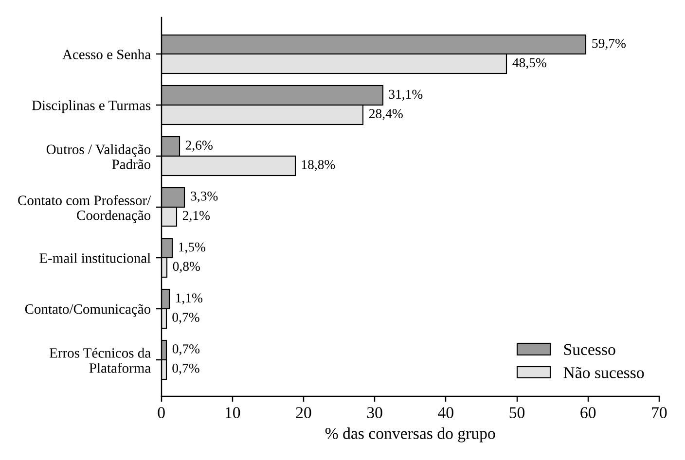
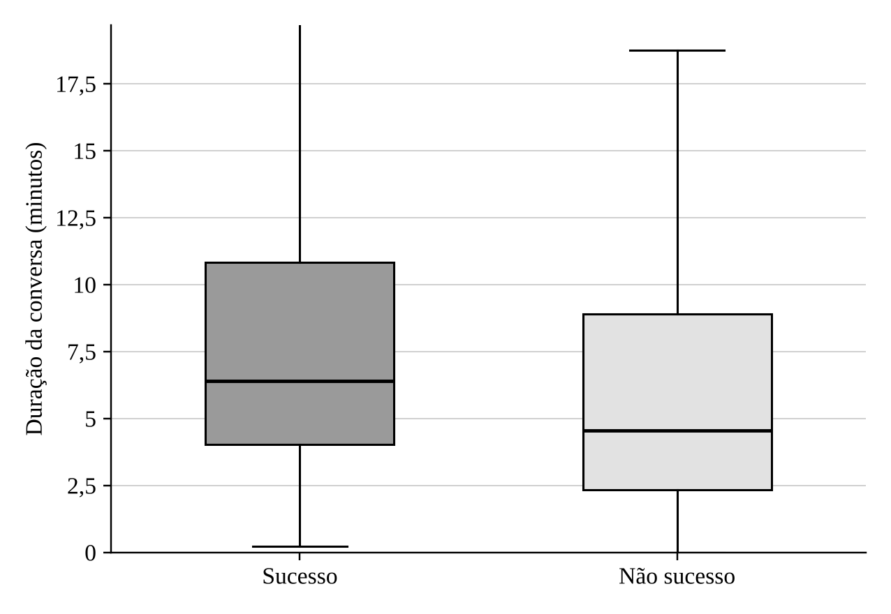
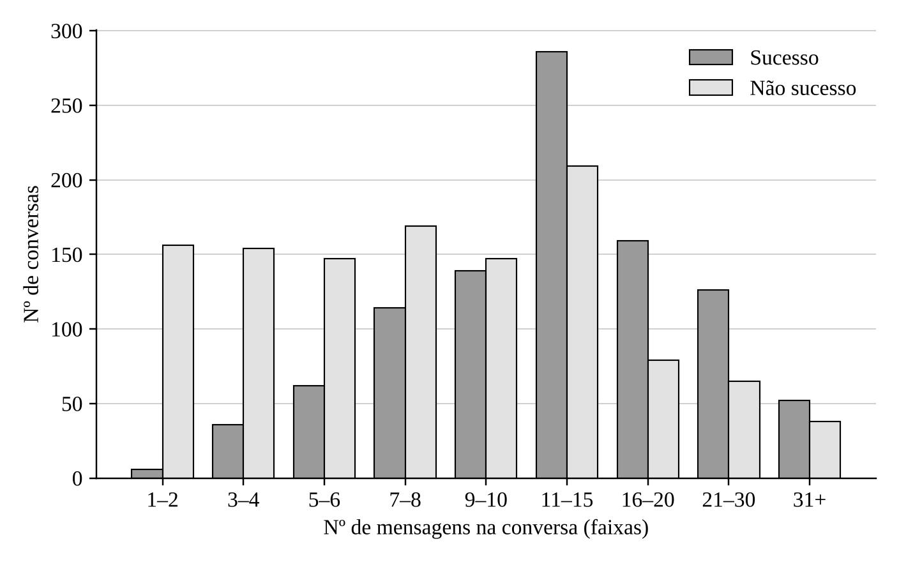

# Support-Chat Analysis for Training an AI Tutor

An **R** pipeline that turns the raw support-ticket history of a distance-learning platform (exported from the Zammad ticketing system) into a corpus of **complete conversations**, labeled by **outcome** and **topic**, to be used as a basis for training and evaluating an AI tutor.

Built by the Statistics group of the extension project **Tutor IA Darcy** (CEAD, University of Brasília), funded under the Capes InovaEDUCAÇÃO call.

> **The data is not included in this repository.** It contains real support conversations and personal data (protected by Brazil's LGPD). Only code, documentation and aggregated figures are published here.

## What it does

1. **Cleaning**: strips HTML, boilerplate messages and empty rows.
2. **Anonymization**: masks e-mail addresses, CPF (national ID) numbers and long digit sequences with regular expressions.
3. **Conversation reconstruction**: groups messages by ticket and orders them by timestamp.
4. **Outcome** (`sucesso` = resolved, `falha_ou_abandono` = failed or abandoned, `indeterminado` = undetermined): keyword rules applied to the last messages of each conversation.
5. **Topics** (up to two per conversation): a keyword dictionary with six categories plus "Other".
6. **Export**: two datasets (successful and non-successful conversations) and a message-level audit file.
7. **Comparative analysis**: Mann-Whitney and chi-square tests, plus a sensitivity analysis of the topic classification.

## Key results

- 26,915 messages across 2,918 tickets (30 Jun 2025 to 2 Jul 2026).
- 2,144 conversations with dialogue (at least 2 messages): 980 successful (45.7%), 207 failed or abandoned (9.7%), 957 undetermined (44.6%).
- Dominant topics: access and password (53.6%) and courses and classes (29.6%).
- Successful conversations are longer: median of 13 messages and 6.39 min, versus 8 messages and 4.55 min for the rest.

| | |
|---|---|
|  |  |
|  | |

The figures above were generated in Python for the project report (labels in Portuguese). The R scripts produce equivalent ggplot2 versions.

## Structure

```
R/
  01_mapeamento_conversas.R      # main pipeline: cleaning, anonymization, outcome, topics, export
  02_graficos.R                  # ggplot2 charts (duration, topics, messages)
  03_grafico_mensagens.R         # binned histogram of message counts
  04_analises_complementares.R   # statistical tests and sensitivity analysis
data/                            # put the exported zammad.csv here (git-ignored)
docs/figuras/
```

## How to run

Requires R and the packages `readr`, `dplyr`, `stringr`, `tidyr`, `purrr`, `ggplot2` and `forcats`.

1. Place the exported file (columns `conversa_id`, `timestamp`, `remetente`, `fala`) at `data/zammad.csv` and adjust `CAMINHO_ARQUIVO` in script 01.
2. Run `R/01_mapeamento_conversas.R`, then the others, in the same session.

Note: script comments and variable names are in Portuguese.

## Limitations

- Outcome and topics are **inferred from keywords** with no manual validation. Next steps: use the official ticket status and validate a sample with multiple raters.
- Proper names are not masked (this would require named-entity recognition).
- Script 04 is the R equivalent of the analyses run in Python for the report. Check its output before citing the numbers.

## Author

Erick Thiago Cardoso Araujo, Statistics undergraduate at the University of Brasília.
